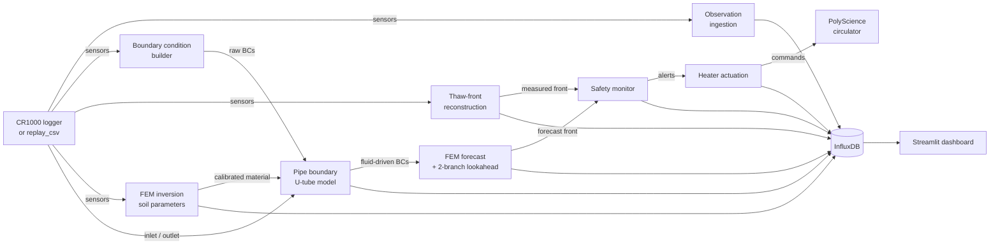

# Permafrost Digital Twin

A real-time digital twin of a laboratory permafrost sample heated by a U-tube
heat exchanger. It ingests thermistor and circulator data, reconstructs the
thaw front, calibrates a 2D finite-element model of freezing soil online,
forecasts where the thaw front is heading, and can close the loop by commanding
the heater through a predictive safety rule engine.

The twin runs as a set of small Python services that communicate over
**RabbitMQ** and store everything in **InfluxDB**. A **Streamlit** dashboard
shows the live state. It runs on **Windows, macOS and Linux**. No lab hardware
is needed to try it: the recorded experiments in `data/` can be replayed through
the full pipeline.

---

## Contents

1. [What the twin does](#1-what-the-twin-does)
2. [Requirements](#2-requirements)
3. [Installation](#3-installation)
4. [Quick start: replay the April 8 experiment](#4-quick-start-replay-the-april-8-experiment)
5. [Run modes](#5-run-modes)
6. [The dashboard](#6-the-dashboard)
7. [Configuration (`startup.conf`)](#7-configuration-startupconf)
8. [Connecting the lab hardware](#8-connecting-the-lab-hardware)
9. [Models inside the twin](#9-models-inside-the-twin)
10. [Tools](#10-tools)
11. [Repository layout](#11-repository-layout)
12. [Running services individually](#12-running-services-individually)
13. [Tests](#13-tests)
14. [Troubleshooting](#14-troubleshooting)

---

## 1. What the twin does



| Service | What it does |
|---|---|
| **Observation ingestion** | Writes each sensor snapshot to InfluxDB. |
| **Boundary condition builder** | Assembles the FEM boundary conditions: a cold Dirichlet anchor at depth, an insulated surface and side, and the pipe interface. |
| **Pipe boundary** | Calibrates a 1D U-tube heat-exchanger model against the measured inlet/outlet temperatures. It then replaces the pipe boundary with a depth-resolved, fluid-driven Robin condition. |
| **FEM inversion** | Fits the soil heat capacity `cap_s`, the freezing-curve steepness `k_parameter` and the grain conductivity `lambda_s` to a sliding window of observations. The calibrated values are fed into the forecast. |
| **FEM forecast** | Advances the 2D phase-change FEM in step with observed time (a nowcast). It also runs a 1 h look-ahead on two branches: *keep heating* and *heater off now*. It runs an uncalibrated baseline as well, so the value of the inversion is visible. |
| **Thaw-front reconstruction** | Interpolates the sensor field and extracts the 0 °C isotherm. It reports `r_max` and `r_min`. |
| **Safety monitor** | Combines the measured and forecast thaw radius against a limit radius and issues `heat` / `reduce` / `stop`. |
| **Heater actuation** | Turns alerts into setpoint commands. |
| **PolyScience control** | Hardware bridge that drives the circulator over RS-232 (hardware mode only). |
| **CR1000 publisher** | Hardware bridge that polls the Campbell CR1000 datalogger over PakBus (sensors and hardware modes). |
| **Dashboard** | Streamlit app that reads InfluxDB. |

---

## 2. Requirements

| | Version | Notes |
|---|---|---|
| **Python** | 3.10 – 3.13 (3.12 recommended) | 64-bit. On Windows, tick *"Add python.exe to PATH"* in the installer. |
| **Docker Desktop** | recent | Runs RabbitMQ and InfluxDB. Docker must be **running** before you start the twin. |
| **Git** | any | To clone the repository. |
| RAM / disk | ≈ 4 GB free RAM, ≈ 2 GB disk | Mostly the two Docker images. |

Downloads:
- Python: <https://www.python.org/downloads/>. On macOS you can instead run `brew install python@3.12`.
- Docker Desktop: <https://www.docker.com/products/docker-desktop/>. Apple-silicon and Intel Macs are both supported.
- Git: <https://git-scm.com/downloads>. On macOS, `xcode-select --install` also installs it.

Check that everything is visible from a terminal:

```bash
python --version        # macOS/Linux may need: python3 --version
docker --version
docker info             # must not error: Docker Desktop has to be running
git --version
```

---

## 3. Installation

The project is installed into its own **virtual environment** (`.venv`). That
keeps its dependencies separate from your system Python and other projects.
Every command below runs from the repository root.

### macOS / Linux (Terminal)

```bash
git clone <repository-url> permafrost_DT
cd permafrost_DT

python3 -m venv .venv                 # 1. create the virtual environment
source .venv/bin/activate             # 2. activate it: the prompt now starts with (.venv)

python -m pip install --upgrade pip   # 3. up-to-date installer
pip install -e .                      # 4. install the twin and its dependencies
```

### Windows (PowerShell)

```powershell
git clone <repository-url> permafrost_DT
cd permafrost_DT

py -3.12 -m venv .venv                # 1. create the virtual environment (or: python -m venv .venv)
.\.venv\Scripts\Activate.ps1          # 2. activate it: the prompt now starts with (.venv)

python -m pip install --upgrade pip   # 3. up-to-date installer
pip install -e .                      # 4. install the twin and its dependencies
```

> **"running scripts is disabled on this system"?** PowerShell blocks the
> activation script by default. Allow local scripts for your user once with
> `Set-ExecutionPolicy -Scope CurrentUser RemoteSigned`, then activate again.
> In the classic Command Prompt (`cmd.exe`), activate with
> `.venv\Scripts\activate.bat` instead.

### Optional extras

```bash
pip install -e ".[hardware]"     # pyserial + pycampbellcr1000, only to drive the lab hardware
pip install -e ".[dev]"          # pytest, to run the test suite
pip install -e ".[hardware,dev]" # both
```

`pip install -e .` makes an *editable* install: code changes take effect
without reinstalling. The dependency lists are in `requirements*.txt`.
`pip install -r requirements.txt` also works if you prefer not to install the
package itself.

### Every new terminal

Activate the environment again before running anything:

```bash
source .venv/bin/activate        # macOS / Linux
.\.venv\Scripts\Activate.ps1     # Windows PowerShell
```

Run `deactivate` to leave it. To start again from scratch, delete the `.venv`
folder and repeat the installation steps.

---

## 4. Quick start: replay the April 8 experiment

This runs the full twin (FEM, inversion, pipe model, safety logic and dashboard)
on the recorded 6.6 h heating experiment. No hardware is involved. You need
**two terminals**, both in the repository root with `.venv` activated.

**Terminal 1: start the twin.**

```bash
python -m software.startup.start_all_services --mode sim
```

The first run downloads the RabbitMQ and InfluxDB images, which takes a few
minutes. Wait until you see `RabbitMQ ready.`, `InfluxDB ready.` and the line
`Starting permafrost DT in 'sim' mode: ...`. Then give the services about 10 s
to connect.

**Terminal 2: replay the data.** On macOS/Linux:

```bash
python -m software.tools.replay_csv \
    --path data/april8_heating/sensors.csv \
    --fluid-path data/april8_heating/fluid.csv \
    --sleep-seconds 2
```

On Windows PowerShell, use the backtick for line continuation, or put it all on one line:

```powershell
python -m software.tools.replay_csv `
    --path data/april8_heating/sensors.csv `
    --fluid-path data/april8_heating/fluid.csv `
    --sleep-seconds 2
```

**Open the dashboard:** <http://localhost:8501>

Each CSV row is one 30 s logger record. `--sleep-seconds 2` therefore replays
the experiment about 15× faster than real time, so all 790 rows take roughly
26 minutes. Keep the value at 1 s or more: the FEM, inversion and look-ahead
need time to process each snapshot, and a faster replay only builds up queues.
Use `--limit N` to replay only the first N rows.

To stop, press **Ctrl+C** in Terminal 1. The Docker containers keep running in
the background; stop them from Docker Desktop or with
`docker rm -f rabbitmq-server influxdb-server`.

> **Data is kept between runs.** InfluxDB stores its data in the Docker volume
> `influxdbserver_influxdb_data`, and every replay writes to the same bucket.
> The dashboard shows the most recent `history_hours`, so an older run can
> appear next to a new one. To start from an empty database:
> ```bash
> docker rm -f influxdb-server
> docker volume rm influxdbserver_influxdb_data
> ```

To replay the 23 h heat-exchanger test instead, use
`--path data/heat_exchanger_test/sensors.csv --fluid-path data/heat_exchanger_test/fluid.csv`.
See [`data/README.md`](data/README.md) for what each dataset contains.

---

## 5. Run modes

```bash
python -m software.startup.start_all_services --mode {sim|sensors|hardware} [--no-docker] [--config FILE]
```

| Mode | Services started | Hardware |
|---|---|---|
| `sim` *(default)* | Every processing service, FEM forecast, inversion, pipe model, safety monitor, heater actuation and the dashboard. Heater commands are computed but go to no device. | none: feed data with `replay_csv` |
| `sensors` | Ingestion, boundary builder, thaw front, dashboard and the **CR1000 publisher**. | CR1000 datalogger |
| `hardware` | Everything in `sim`, plus the **CR1000 publisher** and **PolyScience control**: the full closed loop. | CR1000 + PolyScience circulator |

- In `hardware` mode an interactive **pre-flight check** asks you to confirm the
  heat setpoint and the STOP thaw radius before anything starts.
- `--no-docker` reuses RabbitMQ/InfluxDB containers that are already running.
  Without it, the launcher recreates both containers on every start. The data
  survives because it lives in the volume.
- `--config` points at another configuration file, for example a per-experiment copy.

---

## 6. The dashboard

<http://localhost:8501>. It refreshes every `viz_dashboard.refresh_seconds` seconds.

| Tab | Content |
|---|---|
| **Overview & Safety** | Thaw radius against the limit, the safety state, heater actions, and the closed-loop status widget (sensors → twin → safety → control → circulator) in the sidebar. |
| **Temperature Fields** | Measured and FEM temperature fields with an animated time scrubber, the calibrated twin compared with the uncalibrated baseline, and the FEM error against measurements. |
| **Thaw Front** | 0 °C contour and the evolution of `r_max`/`r_min`, measured against forecast. |
| **Model Parameters** | Inverted soil parameters over time, pipe-model calibration, and predicted against measured outlet temperature. |
| **Energy Analysis** | Energy and efficiency metrics for the heating run. |

Every plot can be exported as high-resolution PNG, SVG or PDF. The temperature
field can also be exported as a GIF.

---

## 7. Configuration (`startup.conf`)

All settings are in `startup.conf` at the repository root. It is JSON, except
that lines starting with `#` are comments. Any section you remove falls back to
the defaults in `software/startup/utils/config.py`. The settings you are most
likely to change:

| Section | Key | Meaning |
|---|---|---|
| `safety_monitor` | `limit_radius_m` | Thaw radius (m) at which heating must stop. Calibrated to **0.040 m** for the April 8 sample. |
| | `warn_fraction`, `critical_fraction` | Warning and critical bands as fractions of the limit (0.6 / 0.9). |
| | `mode` | `dual` (measured thresholds) or `predictive` (measured **and** forecast rules, see [§9](#9-models-inside-the-twin)). |
| | `f2_action` | What the forecast-only "too late to stop" rule does: `stop` or `reduce`. |
| `heater_actuation` | `setpoint_on_ok`, `setpoint_on_reduce`, `setpoint_on_alert` | Circulator setpoints (°C) for heat, reduce and stop. |
| `fem_forecast` | `material` | Initial soil properties. The inversion refines `cap_s`, `k_parameter` and `lambda_s` online. |
| | `enable_lookahead`, `lookahead_hours` | Two-branch predictive forecast (1.0 h by default). |
| | `run_baseline` | Also run an uncalibrated twin for comparison. Costs one extra solve per update. |
| `fem_inversion` | `invert_params`, `relative_bounds`, `window_size` | Which parameters are fitted, within what multiples of the base value, and over how many snapshots. |
| `pipe_boundary` | `fixed_params.v`, `pipe_h_coeff` | Measured fluid velocity (0.338 m/s) and the fluid–soil heat transfer coefficient. |
| `cr1000_publisher` | `port`, `sensors`, `fluid_fields` | Datalogger serial port and the map from logger column to sensor position. |
| `polyscience_control` | `port`, `setpoint_min_c`, `setpoint_max_c`, `dry_run` | Circulator serial port, the setpoint safety clamp, and a test mode that sends nothing to the device. |
| `influxdb`, `rabbitmq` | | Connection settings. They match the Docker containers by default (user, password, token and org are all `permafrost`). |

The FEM mesh (775 nodes, 720 elements, radial 0–0.24 m × depth 0–0.30 m) is in
`software/models/fem_mesh/`. Edge set `bottom` (z = 0) is the soil
**surface**, `top` (z = 0.30 m) is the deep frozen boundary, and `left` is the
pipe axis.

---

## 8. Connecting the lab hardware

Install the hardware extras first: `pip install -e ".[hardware]"`.

### 8.1 Find the serial ports

USB-to-RS232 adapters get a different name on each operating system:

| OS | Port names | How to list them |
|---|---|---|
| **Windows** | `COM3`, `COM5`, … | *Device Manager → Ports (COM & LPT)*, or `python -m serial.tools.list_ports -v` |
| **macOS** | `/dev/tty.usbserial-XXXX` or `/dev/cu.usbserial-XXXX` (use **`cu.`** for outgoing connections) | `ls /dev/cu.*`, or `python -m serial.tools.list_ports -v` |
| **Linux** | `/dev/ttyUSB0`, `/dev/ttyACM0` | `python -m serial.tools.list_ports -v`. Add yourself to the `dialout` group if access is denied. |

Many adapters with Prolific or FTDI chips need a vendor driver on Windows and
macOS. Install it if the port does not appear.

Put the ports into `startup.conf`:

```jsonc
"cr1000_publisher":    { "port": "COM5", ... },   // macOS: "/dev/cu.usbserial-A10KXYZ"
"polyscience_control": { "port": "COM3", ... },   // macOS: "/dev/cu.usbserial-B20LQRS"
```

The two devices **must use different ports**. A serial port can be opened by
only one program at a time, and the launcher refuses to start if both devices
are set to the same port. Close any other program that uses a port, such as
LoggerNet or a terminal emulator, before starting the twin.

### 8.2 Check each device on its own

```bash
python -m software.tools.cr1000_public_test          # CR1000: read the Public table once
python -m software.tools.polyscience_control_serial --port COM3 --baud 57600   # circulator: interactive menu
```

`cr1000_public_test.py` and `cr1000_monitor.py` keep their port in a constant
(`SERIAL_PORT`) near the top of the file. Edit it to match your adapter.

### 8.3 Map the sensors

Each entry in `cr1000_publisher.sensors` links a logger column to a position:

```json
{"field": "H90D45(1)", "sensor_id": "H90D45", "x_m": 0.045, "z_m": 0.09}
```

`H<depth_mm>D<radial_mm>`: `x_m` is the radial distance from the pipe axis and
`z_m` is the depth below the surface, both in metres. The `(1)` suffix is part
of the CR1000 column name. To disable a broken sensor, comment its line out
with `#`. `fluid_fields` names the inlet and outlet columns.

### 8.4 Run

```bash
python -m software.startup.start_all_services --mode sensors    # watch the field, heater untouched
python -m software.startup.start_all_services --mode hardware   # full closed loop
```

To try the actuation chain without powering the circulator, set
`"dry_run": true` in `polyscience_control`.

> ⚠️ In `hardware` mode the twin switches a real heater on and off. Confirm
> `limit_radius_m` and the setpoints for your sample, and keep the controller's
> own over-temperature protection active.

---

## 9. Models inside the twin

**2D phase-change FEM** (`simulator/fem_forecast/fem_solver.py`). Transient heat
conduction with latent heat on a triangular mesh, using implicit time stepping
(`dt` = 30 s, matched to the logger cadence). The unfrozen water saturation
follows a logistic freezing curve with steepness `k_parameter` around 0 °C.
The bulk conductivity and heat capacity are mixed from the soil grains, water
and ice according to porosity and phase saturation. The thaw front is the
interpolated 0 °C isotherm.

**Online inversion** (`simulator/fem_inversion/`). On a sliding window of
observations it minimises the misfit between sensors and FEM for `cap_s`,
`k_parameter` and `lambda_s` within relative bounds. It uses bounded L-BFGS-B
with a seeded start and a single-trajectory forward model, so each fit is fast.
The result overrides the forecast's material properties.

**Pipe boundary model** (`simulator/pipe_boundary/`, core in
`software/tools/run_loop_thermal_case.py`). A 1D finite-volume model of fluid
travelling through the U-tube, coupled to an effective wall temperature. It is
recalibrated against the measured inlet and outlet temperatures every
`recalibrate_seconds` (300 s of wall-clock time; the fluid velocity is fixed at
the measured 0.338 m/s). It produces a depth-resolved fluid
temperature profile that becomes a Robin boundary along the pipe.

**Predictive look-ahead.** At each update the FEM forecast is advanced
`lookahead_hours` on two branches: one keeps the current pipe boundary, and in
the other the heater is cut to `lookahead_stop_setpoint_c`.

**Safety rules** (`control/safety_monitor/`):

- `dual` mode (default) applies thresholds to the measured `r_max`: ok → warning → critical → stop.
- `predictive` mode combines four predicates:

  | Rule | Fires when | Action |
  |---|---|---|
  | **M1** | measured `r_max` ≥ limit | **stop** (never debounced, latched) |
  | **M2** | measured `r_max` ≥ warn fraction × limit | elevated |
  | **F1** | forecast breaches within the horizon if heating continues | confirmed over 3 updates |
  | **F2** | forecast breaches even if the heater is cut now | `f2_action` (stop) |

  Stop trips on M1 **or** F2. Reduce needs M2 **and** F1. A stale measurement
  fails safe, and a stale forecast falls back to the measured rules. A latched
  alert must be cleared by an operator.

---

## 10. Tools

All tools run as modules from the repository root: `python -m software.tools.<name> --help`.

| Tool | Purpose |
|---|---|
| `replay_csv` | Publish a recorded CSV/XLSX (plus optional fluid file) into the twin as if it came from the logger. |
| `prep_cr1000_replay` | Convert a raw CR1000 table (`TIMESTAMP`, `Inlet`, `Outlet`) into replay-ready files. |
| `export_fem_results` | Export FEM forecasts and measured comparisons from InfluxDB to CSV (`data/exports/`). |
| `run_fem_case` | Run the FEM solver offline, without RabbitMQ or InfluxDB (also used as a library by the inversion). |
| `cr1000_monitor` | Stand-alone CR1000 poller that appends records to `cr1000_data.csv`. Use it to log an experiment without the twin. |
| `cr1000_public_test` | CR1000 connection diagnostic. |
| `polyscience_control_serial` | Interactive manual control of the PolyScience circulator. |

---

## 11. Repository layout

```
permafrost_DT/
├── README.md
├── startup.conf                  # all service settings
├── pyproject.toml                # package metadata (pip install -e .)
├── requirements*.txt             # core / hardware / dev dependencies
├── data/                         # demo datasets (see data/README.md)
├── tests/                        # hardware-free unit tests
└── software/
    ├── digital_twin/
    │   ├── communication/        # RabbitMQ client, JSON message schemas, docker-compose
    │   ├── data_access/          # InfluxDB helpers, docker-compose
    │   ├── monitoring/           # ingestion, CR1000 publisher, BC builder, thaw front
    │   ├── simulator/            # FEM forecast, FEM inversion, pipe boundary
    │   ├── control/              # safety monitor, heater actuation, PolyScience bridge
    │   └── visualization/        # Streamlit dashboard
    ├── models/fem_mesh/          # FEM mesh: nodes, elements, boundary edge/node sets
    ├── startup/                  # launcher, per-service entry points, Docker helpers
    ├── tools/                    # CLI utilities (§10)
    └── utils/                    # logging setup
```

The `logs/`, `artifacts/` and `data/exports/` folders are created at run time and ignored by git.

---

## 12. Running services individually

For debugging, start the infrastructure once and run services one per terminal:

```bash
python -m software.startup.docker_services.start_rabbitmq
python -m software.startup.docker_services.start_influxdb

python -m software.startup.start_observation_ingestion_2d
python -m software.startup.start_boundary_condition_builder
python -m software.startup.start_thaw_front_reconstruction
python -m software.startup.start_fem_inversion
python -m software.startup.start_pipe_boundary
python -m software.startup.start_fem_forecast
python -m software.startup.start_safety_monitor
python -m software.startup.start_heater_actuation
python -m software.startup.start_viz_dashboard
python -m software.startup.start_cr1000_publisher      # hardware
python -m software.startup.start_polyscience_control   # hardware
```

RabbitMQ management UI: <http://localhost:15672>. InfluxDB UI:
<http://localhost:8086>. Both use the login `permafrost` / `permafrost`.

---

## 13. Tests

```bash
pip install -e ".[dev]"
pytest
```

The tests cover the inversion service's bookkeeping and the predictive safety
rule engine. They need neither Docker nor hardware.

---

## 14. Troubleshooting

| Symptom | Fix |
|---|---|
| `Cannot connect to the Docker daemon` / `docker: command not found` | Start Docker Desktop and wait until it reports *running*. |
| `Bind for 0.0.0.0:5672 / 8086 / 8501 failed: port is already allocated` | Another RabbitMQ, InfluxDB or Streamlit is running. Stop it, or change the port in `startup.conf` and the matching `docker-compose.yml`. |
| `Service failed to start in time` | First image pulls can be slow, so run again. Check `logs/rabbitmq.log` / `logs/influxdb.log` and `docker logs rabbitmq-server`. |
| `ModuleNotFoundError: No module named 'software'` | Run commands from the repository root with `.venv` activated, using `python -m ...`, and make sure `pip install -e .` succeeded. |
| `python` not found (macOS) | Use `python3` to create the venv. Inside an activated venv, `python` works. |
| `Activate.ps1 cannot be loaded` (Windows) | `Set-ExecutionPolicy -Scope CurrentUser RemoteSigned` |
| Dashboard empty | It shows only the last `history_hours` of data. Check that `replay_csv` is running and that Terminal 1 shows no errors. |
| Dashboard mixes an old run with the new one | Reset InfluxDB (see the note in [§4](#4-quick-start-replay-the-april-8-experiment)). |
| `could not open port` / `Access is denied` / `Resource busy` | Wrong port name, missing adapter driver, or another program holds the port ([§8.1](#81-find-the-serial-ports)). On Linux, join the `dialout` group. |
| `pycampbellcr1000 is not installed` / PolyScience in DRY-RUN | `pip install -e ".[hardware]"` |
| Plot export button fails | `pip install --upgrade kaleido`. Kaleido ≥ 1.0 also needs Chrome or Chromium installed. |
